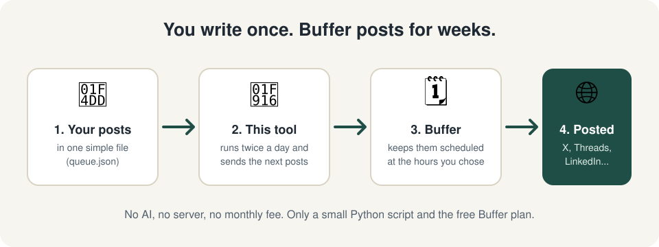
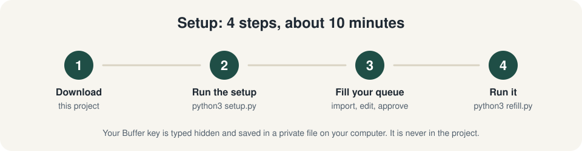
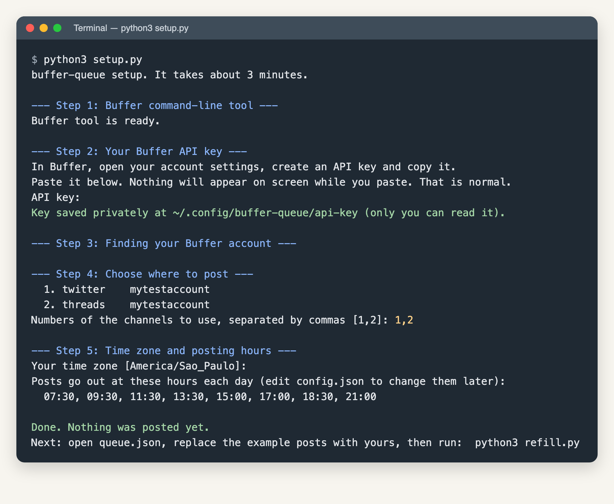
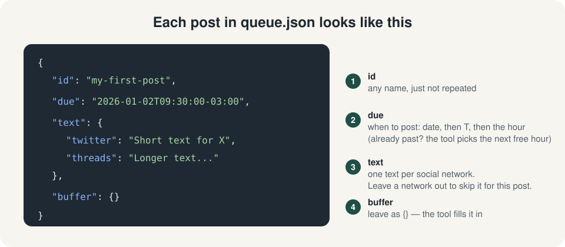
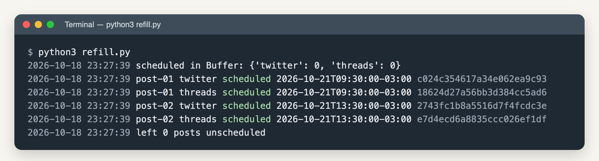
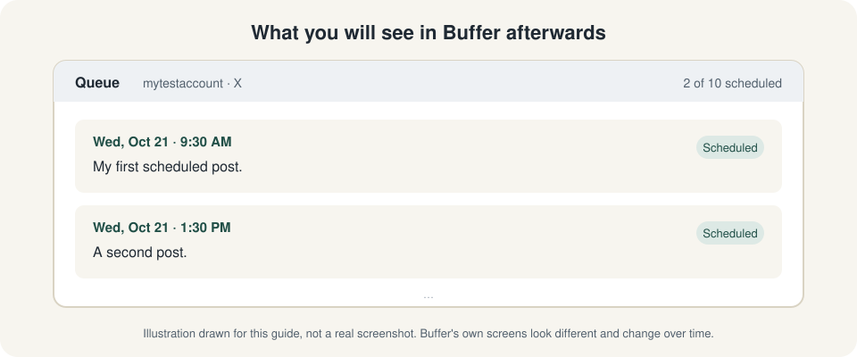

# buffer-queue

**Escreva seus posts uma vez. Deixe sair sozinho por semanas.**



[Read in English](README.md)

## O que é isto?

O [Buffer](https://buffer.com) é uma ferramenta gratuita que publica posts nas suas redes sociais no horário que você escolher. O plano grátis só deixa **10 posts agendados por rede** ao mesmo tempo. Então, a cada poucos dias, você precisa voltar lá e agendar mais.

**O buffer-queue acaba com essa tarefa.** Você guarda todos os posts futuros num arquivo de texto simples. Duas vezes por dia, a ferramenta olha o Buffer, vê quais redes têm espaço e agenda os próximos posts para você. Você escreve quando der vontade. A ferramenta agenda.

É grátis, roda no seu computador, não usa IA nem servidor, e seus posts não vão para lugar nenhum além do Buffer.

## O que você precisa

| Você precisa de | Onde conseguir |
|---|---|
| Conta grátis no Buffer, com pelo menos uma rede conectada | [buffer.com](https://buffer.com) |
| Python 3 | Já vem no Mac. No Windows: [python.org/downloads](https://www.python.org/downloads/) (marque "Add Python to PATH") |
| Node.js (para instalar a ferramenta oficial do Buffer) | [nodejs.org](https://nodejs.org) (botão "LTS") |

Se preferir, um assistente de IA faz a instalação inteira com você: veja o [PROMPT.md](PROMPT.md) (em inglês).

## Instalação em 4 passos



### 1. Baixe este projeto

Nesta página, clique no botão verde **Code** e depois em **Download ZIP**. Abra o ZIP para virar uma pasta chamada `buffer-queue-main`.

### 2. Rode a instalação guiada

Abra um terminal dentro dessa pasta.

- **Mac:** aperte `Cmd + Espaço`, digite `Terminal`, Enter. Digite `cd ` (com espaço), arraste a pasta `buffer-queue-main` para a janela e aperte Enter.
- **Windows:** abra a pasta, clique na barra de endereço, digite `powershell` e aperte Enter.

Depois rode:

```sh
python3 setup.py
```

(No Windows, use `python setup.py`.)

Ele faz algumas perguntas e resolve o resto. É isto que você vai ver (o nome da conta é inventado):



O que ele faz:

1. Instala a ferramenta oficial do Buffer, se faltar.
2. Pede a sua **chave de API do Buffer**. Ela funciona como uma senha que deixa esta ferramenta agendar posts por você. Crie uma nas configurações da sua conta do Buffer (procure a seção de API ou desenvolvedor; a [central de ajuda do Buffer](https://support.buffer.com) tem o passo a passo atual). Cole quando pedir. **Nada aparece na tela enquanto você cola. É normal.**
3. Encontra a sua conta e lista as redes conectadas. Você escolhe quais usar.
4. Pergunta o seu fuso horário e salva tudo.

A chave fica num arquivo privado no seu computador, fora desta pasta. Ela nunca está dentro do projeto, então você não consegue publicá-la sem querer.

### 3. Escreva os seus posts

Abra o `queue.json` em qualquer editor de texto. O setup criou o arquivo com dois posts de exemplo. Troque pelos seus. Cada post é assim:



Dicas:

- Copie um bloco de post inteiro, cole logo depois e edite. Mantenha as vírgulas entre os blocos.
- Os nomes das redes em `text` têm de ser os que o setup mostrou (por exemplo `twitter`, `threads`, `linkedin`).
- Você pode deixar uma rede de fora de um post para pular a rede naquele post.
- Se o arquivo quebrar, um verificador grátis como o [jsonlint.com](https://jsonlint.com) mostra onde.

### 4. Rode

Primeiro, deixe na fila **só um ou dois posts**. Depois:

```sh
python3 refill.py
```

O resultado fica assim:



Abra o Buffer. Os posts devem aparecer agendados, como nesta ilustração:



As telas de terminal acima são saída real desta ferramenta, rodada contra um Buffer simulado com dados inventados. A tela do Buffer é uma ilustração, não um print real. Se estiver certo, coloque o resto dos posts e rode de novo. Pode rodar quantas vezes quiser: a ferramenta nunca agenda o mesmo texto duas vezes.

## Fazer rodar sozinho

Só faça isto depois que o passo 4 funcionar.

- **Mac:** copie `launchd/com.example.buffer-refill.plist` para `~/Library/LaunchAgents/`, troque os dois `/ABSOLUTE/PATH/TO/` pelo caminho real da pasta e rode:

  ```sh
  launchctl bootstrap gui/$(id -u) ~/Library/LaunchAgents/com.example.buffer-refill.plist
  ```

- **Linux:** adicione esta linha com `crontab -e` (ajuste o caminho):

  ```cron
  0 8,20 * * * /usr/bin/python3 -I /caminho/buffer-queue/refill.py >> /caminho/buffer-queue/refill.log 2>&1
  ```

- **Windows:** use o Agendador de Tarefas para rodar `python refill.py` nesta pasta duas vezes por dia.

Opcional: o `watchdog.py` mostra uma notificação no Mac se o reabastecimento parou ou se a fila está quase vazia. Agende da mesma forma.

## Dúvidas e problemas

**Nada acontece quando rodo o `refill.py`.** Leia as últimas linhas que ele escreveu. `scheduled in Buffer: {...}` mostra quantos posts cada rede já tem. Se uma rede está em 10, o limite do plano grátis, a ferramenta espera alguns saírem.

**"config not found".** Rode `python3 setup.py` antes.

**"Buffer answered with an error".** A chave está errada ou venceu. Crie outra e rode o setup de novo.

**Ele posta algo que eu não escrevi?** Não. Só agenda o que está no `queue.json`.

**Quero mudar os horários.** Abra o `config.json` e edite `grid` (formato 24 horas, no seu fuso).

**Quero apagar um post agendado.** Apague no Buffer. Se tirar também do `queue.json`, ele não será agendado de novo.

## Proteja a sua conta

- Nunca compartilhe `config.json`, `queue.json`, os logs nem a chave. Se você copiar este projeto para o GitHub, eles já são ignorados pelo `.gitignore`. Mesmo assim, rode `git status` antes de cada push.
- Nunca cole a chave em chat, issue ou pull request. Se vazar, apague no Buffer e crie outra.
- Use uma chave só para esta ferramenta, para poder apagar sem quebrar mais nada.

## Como funciona por dentro

Para quem gosta de detalhe. O `refill.py` lê o `queue.json`, pergunta ao Buffer quais posts já existem (últimos 21 dias), conta quantos estão agendados por rede e cria os que faltam até o `limit` (10 por padrão). Item atrasado vai para o próximo horário livre da sua `grid`. O id do post do Buffer é gravado de volta no `queue.json`, por isso rodar de novo é seguro. Tudo está em dois arquivos Python pequenos, sem bibliotecas extras.

## Licença

MIT. Use, mude, compartilhe.
